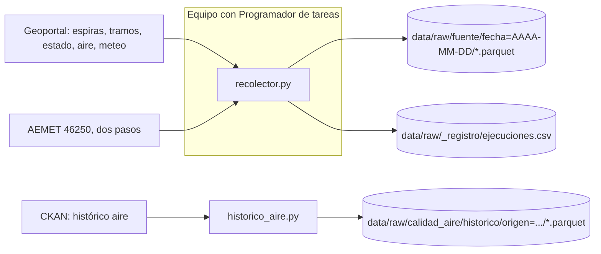

# Proyecto 4 · Big Data urbano (València)

## Bitácora de prácticas → Bloque 1 · Práctica P4: ingesta de datos abiertos urbanos

### Fuentes

| Fuente | Origen | Capa / recurso | Clave | Frecuencia | Script |
|---|---|---|---|---|---|
| Espiras de tráfico | Geoportal (ArcGIS) | Trafico/MapServer/208 | No | Cada hora | recolector.py |
| Tramos de tráfico | Geoportal (ArcGIS) | Trafico/MapServer/188 | No | Cada hora | recolector.py |
| Estado del tráfico | Geoportal (ArcGIS) | Trafico/MapServer/192 | No | Cada 15 min | recolector.py |
| Calidad del aire | Geoportal (ArcGIS) | MedioAmbiente/MapServer/156 | No | Cada hora | recolector.py |
| Meteo municipal | Geoportal (ArcGIS) | MedioAmbiente/MapServer/157 | No | Cada hora | recolector.py |
| Predicción AEMET | AEMET OpenData | municipio/diaria/46250 | Sí (.env) | Cada 6 h | recolector.py |
| Histórico aire 2016-2022 | CKAN València | 2 recursos datastore | No | Una vez | historico_aire.py |

### Diagrama de la ingesta



### Cómo funciona
- **recolector.py**: descarga cada capa con paginación (`resultOffset`) y reintentos ante errores de red, 429 y 5xx. Cada fuente se recoge **por separado**: si una falla, se registra el error y las demás continúan.
- Cada captura se guarda en **Parquet** (snappy), particionada por fecha, con la hora en el nombre del fichero y en la columna `captura_utc`.
- Cada ejecución añade una línea por fuente a `ejecuciones.csv` (`captura_utc, fuente, ok, filas, error`).
- **historico_aire.py**: descarga con `datastore_search` en lotes de 32.000 filas, guarda **todos los valores como texto** y solo normaliza los nombres de columna (`PM2.5` → `pm2_5`). No repite la descarga salvo con `--forzar`.

### Programación (Windows, Programador de tareas)
Equivalente al `cron` de Linux:

| Tarea | Fuentes | Frecuencia | Justificación |
|---|---|---|---|
| P4_horario | espiras, tramos, aire, meteo | Cada hora, minuto 15 | Datos horarios: una foto por hora no pierde información |
| P4_estado | estado | Cada 15 min | Cambia cada pocos minutos; en batch basta una muestra |
| P4_aemet | aemet | Cada 6 h | Respeta el límite de peticiones y cubre las 24 h |

Se usa `pythonw.exe` (sin ventana) y "no iniciar una nueva instancia" si la anterior sigue en marcha (equivale a `flock -n`).

### Incidencias encontradas
- El histórico no está dentro del conjunto "desde 2016": está en dos conjuntos aparte (`rvvcca_d_horarios_2016-2020` y `rvvcca_d_horarios_2021-2022`), localizados con `package_search?fq=tags:aire`.
- El recurso "2016-2021" del portal se titula **2016-2020** y su datastore tiene **352.666 filas**, frente a las ~449.000 esperadas. El de 2021-2022 trae **201.480** filas, como se esperaba.
- Algunas estaciones de aire no miden todos los contaminantes (`null`, por ejemplo Boulevar Sur en PM10/PM2.5): hay que ignorar nulos al agregar.
- AEMET: se usa la predicción diaria del municipio **46250** (URLs del enunciado) en lugar de la estación 8416.
- Hueco de unas 5 h la noche del 28/10 (equipo apagado o suspendido): esas capturas se pierden. En producción debería correr en un servidor siempre encendido.
- Corte de DNS (`NameResolutionError`) de 03:30 a 04:15 UTC del 29/10: todas las fuentes fallaron, quedó registrado en `ejecuciones.csv` y la siguiente ejecución se recuperó sola.

### Uso
```
python -m venv .venv
.venv\Scripts\Activate.ps1
pip install requests pyarrow python-dotenv
# Crear .env con: AEMET_API_KEY=...
python recolector\recolector.py            # todas las fuentes
python recolector\recolector.py estado     # solo una
python ingesta\historico_aire.py           # histórico (una vez)
```